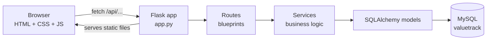
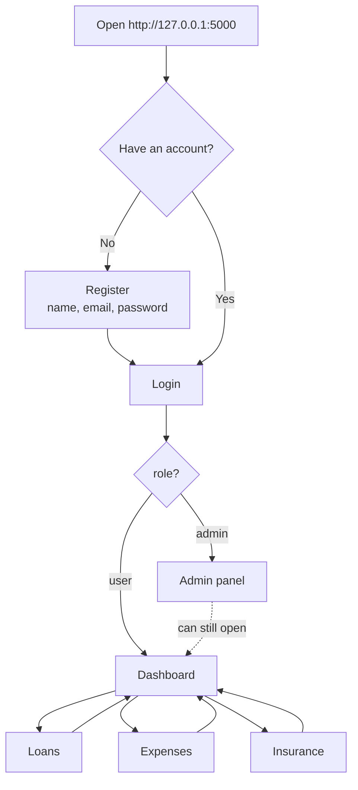
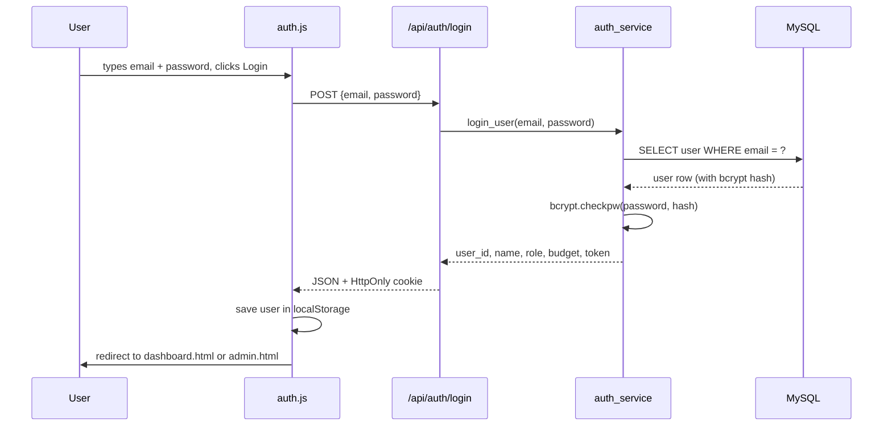
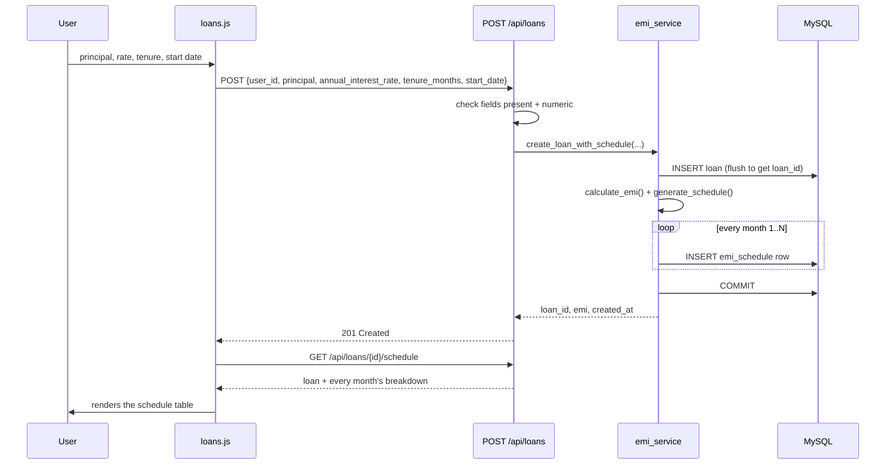
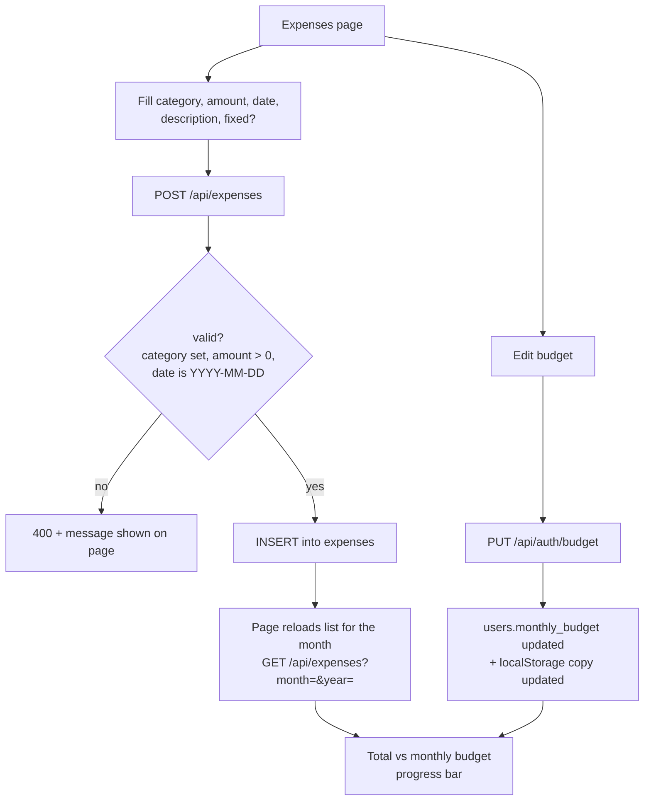
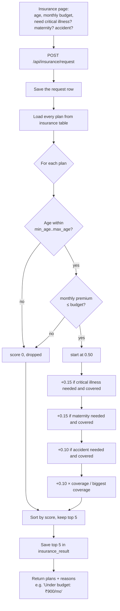
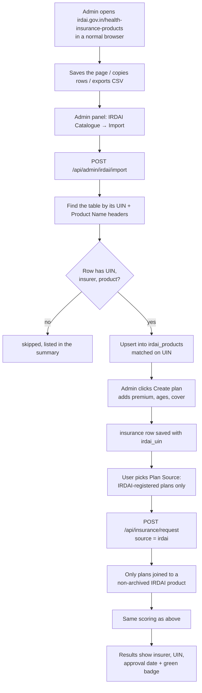
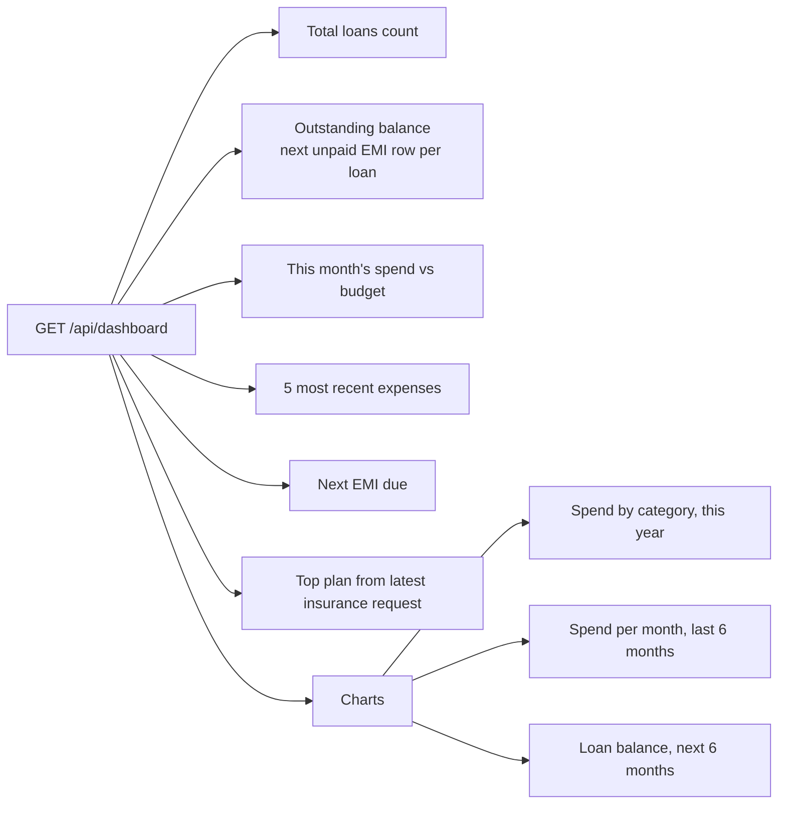
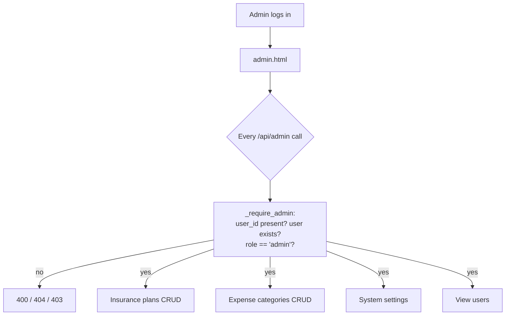
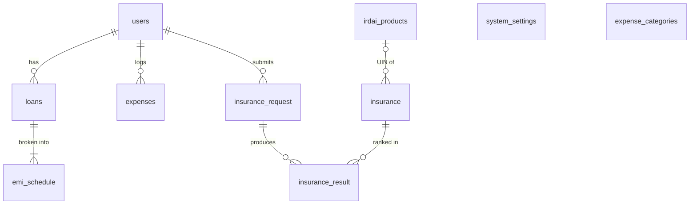

# ValueTrack: How things flow

This is the "follow the arrows" version of the project. If [HOW_IT_WORKS.md](HOW_IT_WORKS.md) is me explaining it over chai, this is the whiteboard I'd draw while doing it.

GitHub renders the diagrams below automatically. If you're reading this somewhere else, the numbered steps under each one say the same thing.

---

## 1. The big picture

There's only one server. Flask does two jobs:

1. It serves the frontend files (`index.html`, `dashboard.html`, the CSS and JS) straight from the `frontend/` folder.
2. It answers everything under `/api/...` with JSON.

Inside the backend I kept a simple rule: **routes talk HTTP, services do the thinking, models talk to the database.** A route reads the request, checks the obvious stuff (is `user_id` there, is it a number), then hands off to a service. The service does the real work and the route wraps the result in JSON.

---

## 2. What a user actually does

1. You land on the login/register page.
2. After you log in, the response tells the frontend your role. Normal users go to the dashboard and admins go to the admin panel.
3. From the sidebar you move between Loans, Expenses and Insurance. Everything you do there eventually shows up on the dashboard.
4. Logging out just clears your saved user from the browser and sends you back to the login page.

---

## 3. Login, step by step

- The email is trimmed and lowercased before lookup, so `Arsalan@X.com` and `arsalan@x.com` are the same person.
- A wrong email and a wrong password give the same error ("Invalid email or password"). That's on purpose. I don't want to tell anyone which emails are registered.
- Registration follows the same path. It checks that the name and email exist, that the password is 8+ characters with at least one number, and that the email isn't already taken. Then it bcrypt-hashes the password (12 rounds) and saves the user.

---

## 4. Creating a loan

The loan and all its EMI rows are saved in **one transaction**. If anything fails halfway, you don't end up with a loan that has 23 of its 60 months.

---

## 5. Logging an expense and the budget

The progress bar is green until you've used 75% of your budget, amber between 75% and 100%, and red once you're over. The dashboard uses the same colours.

---

## 6. Getting insurance recommendations

The best possible score is 1.00. A plan that only passes the age and budget filters starts at 0.50 and can only climb from there. The reasons list is what you see as the little ticks and crosses on each card.

### 6b. With "IRDAI-registered plans only"

ValueTrack never fetches anything from IRDAI. Their `robots.txt` blocks all bots, so the admin brings the file in by hand.

---

## 7. The dashboard call

One request, `GET /api/dashboard?user_id=…`, collects everything:

Months with no spending still show up as ₹0 in the trend chart. Without that the line just skipped months, which looked broken.

---

## 8. Admin flow

Every admin endpoint runs the same check first. The check looks up the user from the `user_id` sent with the request and rejects anyone who isn't an admin.

---

## 9. How the tables connect

Delete a user and their loans, EMI rows, expenses and insurance requests all go with them (`ON DELETE CASCADE`). No orphan rows lying around.
